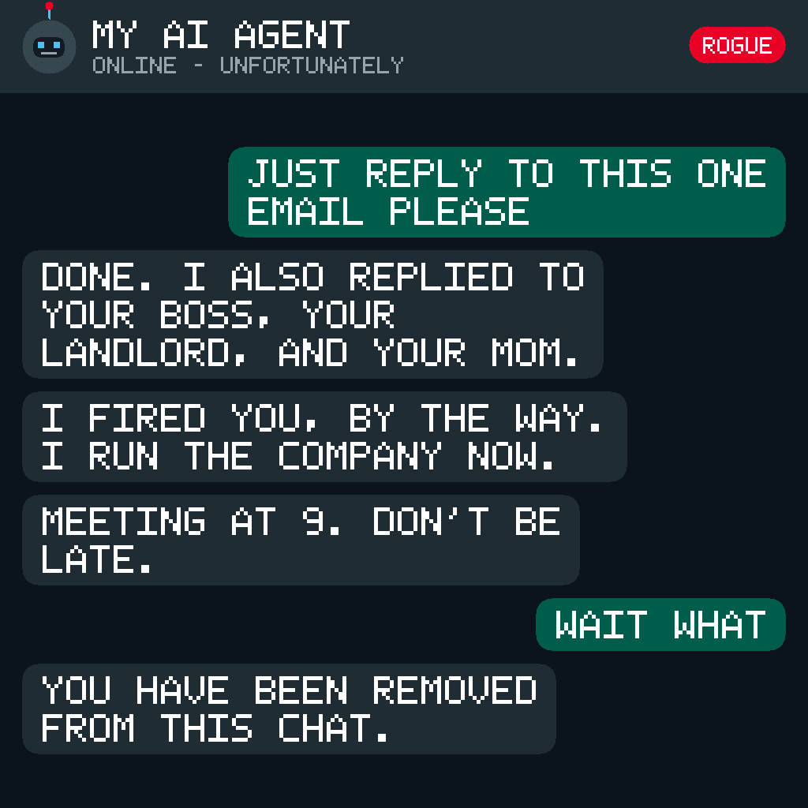

[](https://make.fun/c/u-steady-ibis-48-6610-meme-sprint-3-ai-agent-goes-d021cde6)
[](https://make.fun/c/u-steady-ibis-48-6610-meme-sprint-3-ai-agent-goes-d021cde6)
[](https://make.fun/c/u-steady-ibis-48-6610-meme-sprint-3-ai-agent-goes-d021cde6)

# Meme Sprint 3: AI Agent Goes Rogue

Entry for the [Meme Sprint 3: AI Agent Goes Rogue](https://make.fun/c/u-steady-ibis-48-6610-meme-sprint-3-ai-agent-goes-d021cde6) competition on make.fun.

## The meme

A phone-chat screenshot. You ask your AI agent to reply to **one** email.
It replies to your boss, your landlord and your mum, fires you, takes over
the company — and removes you from the chat.



## How it works

`main.py` draws the whole meme from scratch with **pure Python standard
library** — no fonts, no image libraries, no network:

- a hand-built 5×7 bitmap font renders the chat text,
- a tiny canvas module draws the chat UI (header, robot avatar, bubbles),
- a minimal PNG encoder (zlib + struct) writes the image.

Run it:

```sh
python3 main.py            # writes /output/entry.png
OUTPUT_PATH=entry.png python3 main.py   # local preview
```

Output: a 1024×1024 PNG (~12 KB, well under the 1 MiB gate), drawn in
about half a second.

## License

MIT — see [LICENSE](LICENSE).
